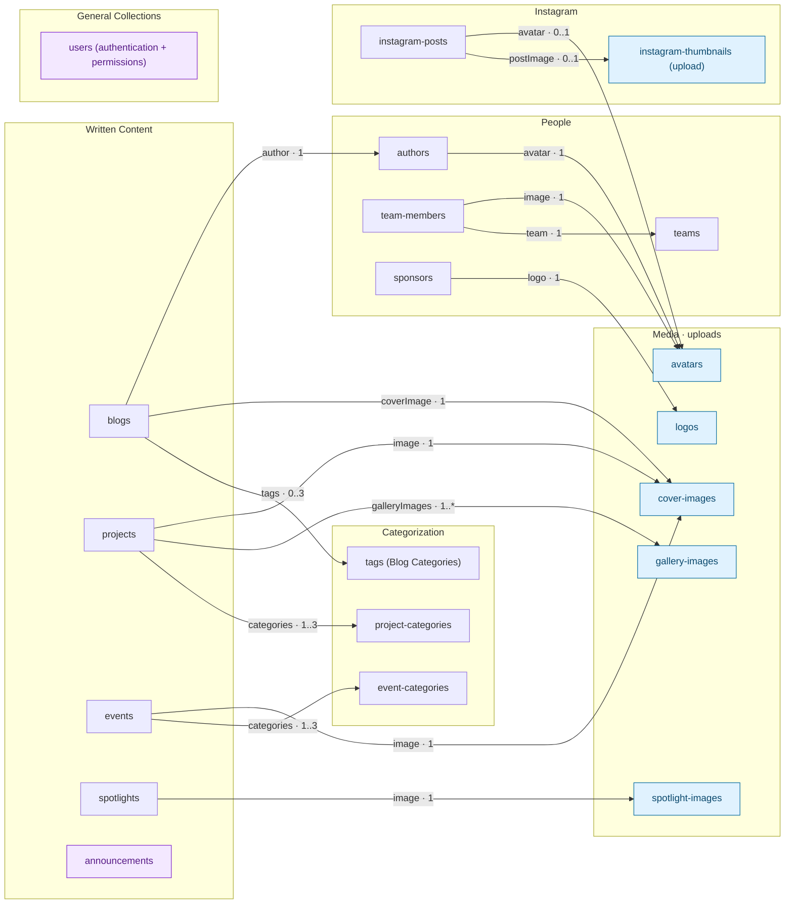

# Payload collection architecture

This map covers all **20 application collections** registered in [`payload.config.ts`](../../payload.config.ts) and their **15 explicit relationship fields**. Definitions live in [`src/cms/collections`](../../src/cms/collections). It excludes frontend fetching, generated database tables, and Payload's internal collections. Groups match the Payload admin sidebar.

## Collection map

Arrows run from the document containing a relationship field to its target collection. Labels give the field name and the number of targets per source document: `1` = required single, `0..1` = optional single, `0..3` = optional list capped at three, `1..3` = required list capped at three, `1..*` = required list with no configured maximum. These are field constraints for validated content; drafts may be incomplete. Targets can be reused by multiple source documents.



Blue nodes are upload collections. Purple nodes have no explicit collection relationships. Rich-text content is not expanded into edges here; the map describes declared `relationship` fields.

## How to read the model

- **Content references reusable records.** Blogs reference authors and blog categories (`tags`); events and projects have separate category collections. `cover-images` is shared by blogs, events, and projects despite its `blog-title` metadata field.
- **People and accounts are separate.** `users` authenticates CMS editors. There is no relationship from users to `authors` or `team-members`, or between authors and team members. A team member references one team; teams do not declare a reverse members field.
- **Some apparent links are plain text.** `projects.creator`, `projects.contributors`, and `projects.blogUrl` are not relationships. Neither are `spotlights.projectName` or `spotlights.tags`; spotlights do not reference `projects` or the `tags` collection.
- **Announcements stand alone.** Their fields are `title` and rich-text `announcement`.
- **Uploads are separate collections.** All six use `disableLocalStorage: true` and are registered with the S3 plugin in `payload.config.ts`. File storage uses the configured Supabase S3-compatible endpoint; collection records use the Postgres adapter. `Media.ts` defines all six; the `spotlight-images` export is currently spelled `SporlightImages`.

## Drafts and access

| Collections | Configured draft behavior |
| --- | --- |
| `blogs` | Drafts, autosave every 1 second; admin preview callback |
| `projects` | Drafts, autosave every 5 seconds; admin preview callback |
| `authors`, `team-members`, `teams`, `sponsors`, `tags`, `project-categories`, `event-categories`, all six upload collections, `events` | Drafts enabled; no explicit autosave configuration |
| `users`, `announcements`, `spotlights`, `instagram-posts` | No versions/drafts configured |

[`collectionAccess.ts`](../../src/cms/access/collectionAccess.ts) supplies `generalAccess` to every collection except `users` and `announcements`:

- `read` currently returns `true`, with **no published-only filter**. The nearby comments describing a `_status` filter refer to commented-out code.
- `create` and `update` allow admins or a user whose `allowedCollections` includes the collection slug. Permission to edit a content collection does not automatically grant permission to edit its referenced collections.
- `delete` permits admins only.

`users.allowedCollections` is a multi-select of slug strings, not a relationship field. `users` has its own access rules: admins create/delete accounts; read/update return an own-ID constraint for non-admins. Updates to `role` and `allowedCollections` are admin-only at field level. Selecting `users` in `allowedCollections` does not override these custom rules.

`announcements` explicitly allows public reads, does not use `generalAccess`, and is absent from the assignable collection list. Its create/update/delete access is not explicitly configured in this repository.

## Maintaining and exporting the diagram

GitHub renders the Mermaid block above directly. Update it whenever collection registration, relationship fields, cardinalities, or admin groups change. Check the live TypeScript definitions, not just generated `payload-types.ts` or seed fixtures.

To export an SVG from the CLI, extract the diagram and run Mermaid CLI (requires `mmdc` to be installed separately):

```bash
sed -n '/^```mermaid$/,/^```$/p' docs/cms-devs/payload-collections-architecture.md | sed '1d;$d' > /tmp/payload-collections.mmd
mmdc -i /tmp/payload-collections.mmd -o /tmp/payload-collections.svg -b white
```

For collection changes, see [Creating a Payload Collection](creating-a-payload-collection.md). The separate [fetching architecture guide](cms-collections-guide.md) describes how application code consumes these collections.
